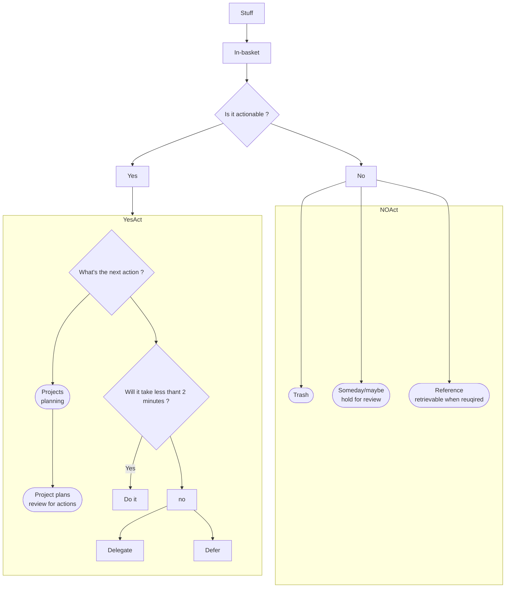

# Getting Things Done

> The Art of Stress-Free Productivity

The book is divided into three parts. Part 1 describes the whole game, providing a brief overview of the system and an expalanation of why it's unique and timely, and then presenting the basic methodologies themselves in their most condensed and basic form. Part 2 shows you how to implement the system. It's your personal coaching, step by step, on the nitty-gritty application of the models. Part 3 goes even deeper, describing the subtler and more profound results you can expect when you incorporate the methodologies and models into your work and your life.

## A New Practice for a new Reality

The methods I present here are all based on three key objectives:

1. capturing all the things that might need to get done or have usefulness for you--now, later, someday, big, little, or in between--in a logical and trusted system outside your head and off your mind;

2. directing yourself to make front-end decisions about all the "inputs" you let into your life so that you will always have workable inventory of "next actions" that you can implement or renegotiate in the moment;

3. curating and cooridinating all of that content, utilizing the recognition of the multiple levels of commitments with yourself and other you will have at play, at any point in time.

### The Problem: New Demands, Insufficient Resources

A paradox has emerged in this new millennium: people have enhanced quality of life, but at the same time they adding to their stress by taking on more than they have resources to handle.

#### Work No Longer Has Clear Boundaries

Now, for many of us, there are no edges to most of our projects. Most people I know have at least half a dozen things they're tring to achieve or situations they'd like to improve right now, and even if they had the rest of their lives to try, they wouldn't be about to finish these to perfection.

    *We can never really are prepared for what which is wholly new. We have to adjust ourselves, and every radical adjustment is a crisis in self-esteem; we undergo a test, we have to prove ourselves. It needs subordinate self-confidence to fact drastic change without inner trembling.*

                                    *--Eric Hoffer*

#### The Big Picture vs. the Nitty-Gritty

> Nitty-Gritty
> 
> The core or essense of something

In practice, however, the well-intentioned exercise of values thinking too often does not achieve its desired results.

Focusing on primary outcomes and values is a critical exercise, certainly. It provides needed criteria for making sometimes-difficult choices about what to stop doing, as well as what most ought ot have our attention amid our excess of options.

#### The Promise: The "Ready State" of the Martial Artist

*Life is denied by lack of attention, whether it be to cleaning windows or trying to write a masterpiece.*

                                    *--Nadia Boulanger*

#### The Principle: Dealing Effectively with Internal Commitments

*Anything that does not belong where it is, the way it is, is an "open loop", which will be pulling on your attention if it's not approprately managed.*open loop

**The Basic Requirements for Managing Commitments**

Managing commitments well requires the implementation of some basic activities and behaviors:

- First of all, if it's on your mind, your mind isn't clear. Anything you consider unfinished in any way must be captured in a trusted system outside your mind, or what I call a collection tool, that you know you'll come back to regularly and sort through.

- Second, you must clarify exactly what your commitment is and decide what you have to do, if anything, to make progress toward fulfilling it.

- Third, once you've decided on all the actions you need to take, you must keep reminders of them organized in a system you review regularly.

**An Important Exercise to Test This Model**

- Describe, in a single written sentence, your intended successful outcome for this problem or situation.

- Write down the very next physical action required to move the situation forward.

But what created that? Not "getting organized" or "setting priorities." The answer is, thinking. Not a log; just enough to solidify your commitment about a discrete pressure or opportunity and the resources required dealing with it. If you actually did this suggested exercise, you are required to structure you thinking toward an outcome and an action, and that does not usually happend without a consciously focus effort. **Reacting is automatic, but thinking is not.**

**The Real Work of Knowledge Work**

We're never really taught that we have to think about our work before we can do it; much of our daily activity is already defined for us by the undone and unmoved things staring at us when we come to work, or by the family to be fed, the launday to be done, or the children to be dressed at home. Thinking in a concentrated manner to define desired outcomes and requisite next action is something few people feel they have to do (until they have to). But in truth, it is the most effective means available for making wishes a reality.

**Why Things Are on Your Mind**

Most often, the reason something is on your mind is that you want it to be different than it currently is, and yet:

- You haven't clarified exactly what the intended outcome is;

- You haven't decided what the very next physical action step is; and/or

- You haven't put reminders of the outcome and the action required in a system you trust.

---

#### The Transformation of "Stuff"

Here's how I define "stuff": anything you have allowed into your psychological or physical world that doesn't belong where it is, but for which you haven't yet determined what, exactly, it means to you, with the desired outcome and the next action step. The reason most organizing systems haven't worked for most people is that they haven't yet transformed all the stuff they're trying to organize. As long as it's still stuff, it's not controllable.

*We need to transform all "stuff" we've attracted and accumulated into a clear inventory of meaningful actions, projects, and usable information.*

#### The Process: Managing Action

Before you can chieve any of that, though, you'll need to get in the habit of keeping nothing on your mind. and the way to do that, as we've seen, is not by managing time, managing information, managing priorities. After all:

- you don't manage five minutes and wind up with six.

- you don't manage information overload--otherwise you'd walk into a library and die, or the first time you connected to the Web, you'd blow up;

- you don't manage priorities--you have them.

Instead, **the key to mananging all of you r stuff is managing your actions.**

##### Managing Action Is the Prime Chanllenge

In training and coaching many thousnds of people, I have found that lack of time is not the major issue for them (though they may think it is); **the real problem is a lack of clarity and definition about what a project really is, and what associated next-action stepds are required.** Clarifying things on the front end, when they first appear on the radar, rather then on the back end, after trouble has developed, allows people to reap the benefits of managing action.

Getting things done requires two basic components: defining (1) <mark>what "done" means</mark> (outcome) and (2) <mark>what "doing" looks like (action).</mark> And these are for from self-evidence for most people about most things that have their attention.

##### Horizontal and Vertical Action Management

Horizontal maintains coherence across all the activities in which you are involved.

Vertical control, in contrast, manage thinking, development, and coordination of individual topics and projects.

##### The Major Change: Getting It All Out of Your Head

There is no reason to ever have the same thought twice, unless you like having that thought.

I try to make intuitiive choices based on my options, instead of trying to think about what those options are. I need to have thought about all of that already and captured the results in a trusted way. I don't want to waste time thinking about things more than one. That's an inefficient use of creative energy and a source of frustration and stress.

> Premise:
> 
> The short-term-memory part of your mind--the part that tends to hold all of the incomplete, undecided, and unorganized stuff--functions much like RAM (random-access memory) on a computer. You can think about only two or three things at once.

---

## Getting Control of Your Life: The Five Steps of Mastering Workflow

The core process for mastering the art of relaxed and controlled engagement is a five-step method for managing your workflow--the  ever-present ingestion and expressions of our experiences.

These procedures I will describe work together as a whole, and using them to produce results is both easier and more chanllenging than you may think.

#### <mark>Five Steps</mark>

We (1) **capture** what has our attention; (2) **clarify** what each item  means and what to do about it; (3) **organize** the results, which presents the options we (4) **reflect** on, which we then choose to (5) **engage** with.

The method is straightforward enough in principle, and it is generally how we all go about our work in any case, but in my experience most people can significantly improve their handling of each one of the five steps. The quality of our workflow management is only as good as the weakest link in this five-phase chain, so all the links must be integrated and supported with consistent standards.

*Ask yourself, "When do I need to see what, in what form, to get it off my mind?" You build a system for function, not just to have a system".*

I have discovered that one of the major reasons many people haven't had a log of success with getting organized is simply that they have tried to do all five steps at one time.

---

#### Capture

**Gathering 100 Percent of the Incompletes**

In order to eliminate "holes in your bucket," you need to collect and gather placeholders for, or representations of, all the things you consider incomplete in your world--that is, **anything personal or professional, big or little, of urgent or minor importance, that you think ought to be different thatn it currently is and that you have any level of internal commitment to changing.**

As soon as you attach a "should", "need to", or "ought to" to an item. it becomes an incomplete. Dicisions you still need to make about whether or not you are going to do something, for example, are already incompletes. This includes all of your I'm-going-tos, in which you've decide to do something but haven't started moving on it yet.

In order to manage this inventory of open loops appropriately, you need to capture it into "**containers**" that hold itmes in abeyance until you have a few moments to decide what they are and what, if anything, you're going to do about them.

Basically, everything potentially meaningful to you is already being collected, in the larger sense.

**The Capture Tools**

- Physical in-tray

- Paper-based note-taking devices

- Digital/audio note-taking devices

- E-mail and text messaging

**Success Factors for Caupturing**

- Get it all out of your head

Keep everything in your head or out of your head. If it's in between, you won't trust either one. These collection tools should become part of your lifestyle.

- Minimize the Number of Capture Locations

Funnel all potentially meaningful inputs through minimal channels, directed to you for easily accessed review and assessment about their nature.

- Empty the Capture Tool Regularly

Too much stuff is left piled in in-trays (physical and digital) because of a lake of effective systems "**downstream**" from there.

---

#### Charify

##### Is It Actionable ?

What's the Next Acion ? This is the critical question for anything you've captured; if you answer it appropriately, you'll have the key substantive thing to organize. The "next action" is the next physical, visible activity that needs to be engaged in, in order to move the current reality of this thing forward completion.

Do It, Delegate It, or Defer It Once you've decided on the next action, you have three options:

1. Do it. if an action will take less than two minutes, it should be done at the moment it is defined.

2. Delegate it. If the action will take longer than two minutes, ask yourself, Am I the right person to do this? If the answer is no, delegate it to the appropriate entity.

3. Defer it, If the action will take longer than two mintues, and you are the right person to do it, you will have to defer acting on it until later and track it on one or more "Next Actions" list.

---

#### Organize

Being organized meas simply that where something is matches what it means to you.

##### Projects

I define a project as any desired result that can be accomplished within a year that requires more than one action step. 

Projects do not initally need to be listed in any particular order, by size, or by priority. They just need to be on a master list so you can review them regularly enough to ensure that appropriate next actions have been defined for each of them.

You don't actually do a project; you can only do action steps related to it. When enough of the right actions steps have been taken, some situation will have been created that matches your initial picture of the outcome closely enough that you can call it "done". The list of project is the compilatoin of finish lines we put before us to keep our next actions moving on all tracks appropriately.

**Project Support Material**

Your projects list will be merely an index. All of the details, plans, and supporting information that you may need as you work on your various project should be contained in separated file folders, compute files, notebooks, or binders.

I usually recommend that people store their support materials out of sight. 

There will be times, though, when it'll be more convenient to have the materials out and instantly in view and available, especially if you're working on a hot project that you need to check references for serveral times during the day.

**The Next-Action Categories**

Any less-than-two-minutes actoins that you perform, and all other actions that have already been completed, do not, of course, need to be tracked; they're done.

What does need to tracked is 

1. every action that has to happen at specific time or on a specific day (enter those on your calendar);

2. those that need to be done as soon as they can (add these to your Next action lists); 

3. all those that you are waiting for others to do (put these on a Waiting For list).

> Calendar

Three things go on your calendar:

- time-specific actions;

This is a fancy name for appointments.

- day-specific actions;

These are things that you need to do sometime on a certain day, but not necessarily at a specific time.

- day-specific information;

The calendar is also the palce to keep track of things you wnat to know about on specific days--not necessarily actions you'll have to take but rather information that may be useful on a certain date.

**But such lists embedded on a calendar don't work, for two reasons.**

First, constant new input and shifting tactical priorities reconfigure daily work so consistantly that it's virtaully impossible to nail down to-do items ahead of time.

Second, if there's something on a daily to-do list that doesn't absolutely have to get done that day, it will dilute the emphasis on the things that truly do.

That said, there's absolutely nothing wrong with creating a quick, informal, short list of "if I have time, I'd really like to ..." kinds of things, picked from your Next Action inventory. It just should not be confused with your "have-tos", and it should be treated lightly enough to discard or change quickly as the inevitable surprises of the day unfold.

##### Nonactionable Items

**Trash**

Trash should be self-evident. Throw away, thred, or recycle anything that has no potentail action or reference value.

**Incubation**

There are two kinds of incubation tools that could work for this kind of thing: Someday/Maybe lists and a tickler system.

- *Someday/Maybe*

It can be useful and inspiring to maintain an ongoing list of things you might want to do at some point but not now. This is the "parking lot" for projects that would be impossibile to move on at present but that you don't want to forget about entirely.

- *Tickler System*

A second type fo things to incubate are those you don't want or need to be remainded of until some designed time in the future. Your calendar can serve the same function.
